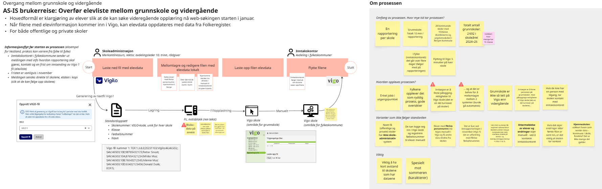

## Current situation (AS-IS process): Transfer of the pupil list from primary and lower secondary school to upper secondary school

The process concerns the transfer of pupil data from primary and lower secondary school to upper secondary school in connection with the transition between the schools. The purpose of the process is to prepare pupils in the county authorities so that they can apply for upper secondary education at the beginning of January. The process outlined below describes this in detail.

The main challenges in the current process relate to the fact that it is largely manual on the municipalities' side. School administration staff in primary and lower secondary schools must download files from line-of-business systems (e.g. Vigilo), store and edit the files locally on a PC, before the edited files are uploaded to the county authority's line-of-business system (Vigo). The process is relatively simple, but is perceived as unnecessary, since it should largely have been automated. In addition, storing files locally involves a security risk, as data can go astray from files that are stored (and not deleted) locally.

