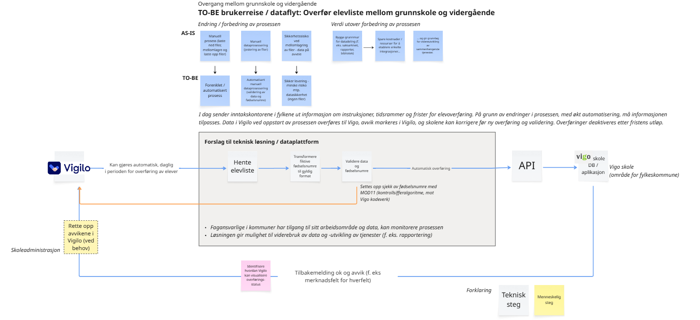
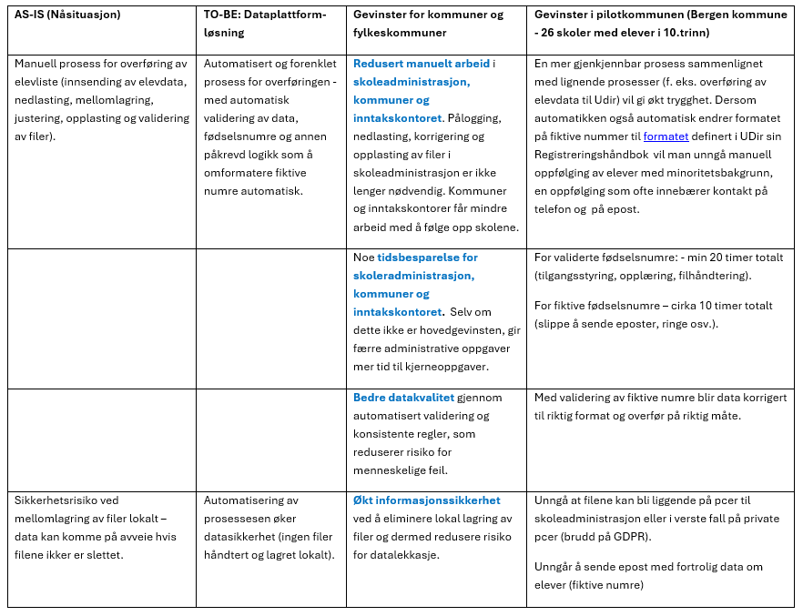
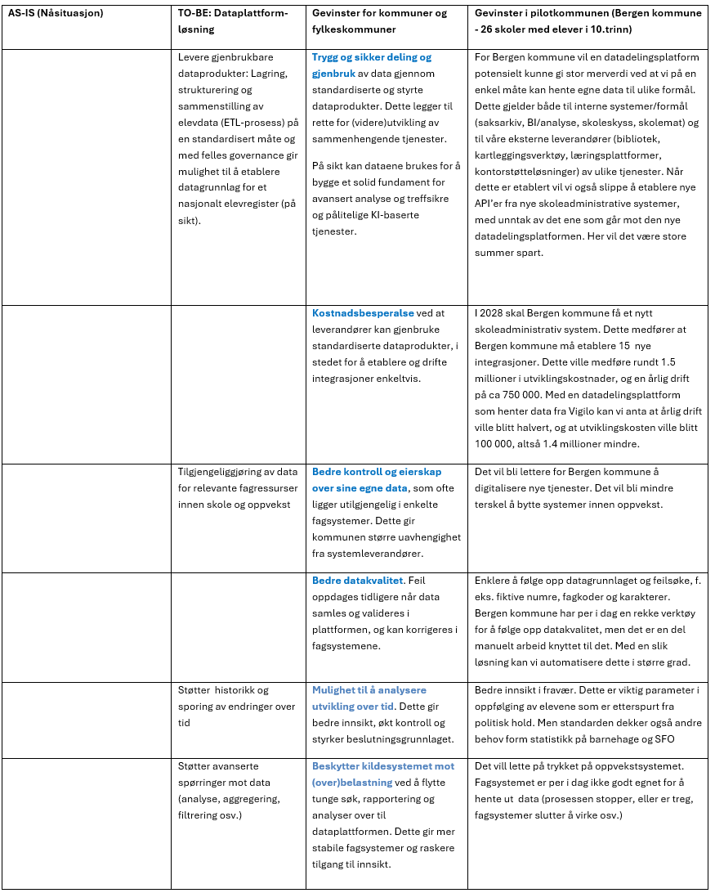

The sketch below describes how the transfer of pupil lists between lower secondary school and upper secondary school is **simplified, automated and more secure** by using a data platform solution as an intermediate layer (KS Digital service platform). The main change is a move away from manual file handling towards a **data-driven and automated data flow** between the systems. In addition, the data platform solution is built in a way that provides a basis for further use of data (e.g. reporting, statistics) and further development of seamless services.

**Benefits**

The benefits are structured in two categories:

1. Operational benefits – related to improving the process for transferring pupil data
2. Strategic benefits – related to establishing and using a data platform as an intermediate layer

**Operational benefits – related to improving the process for transferring pupil data**

**Strategic benefits – related to establishing and using a data platform as an intermediate layer**

