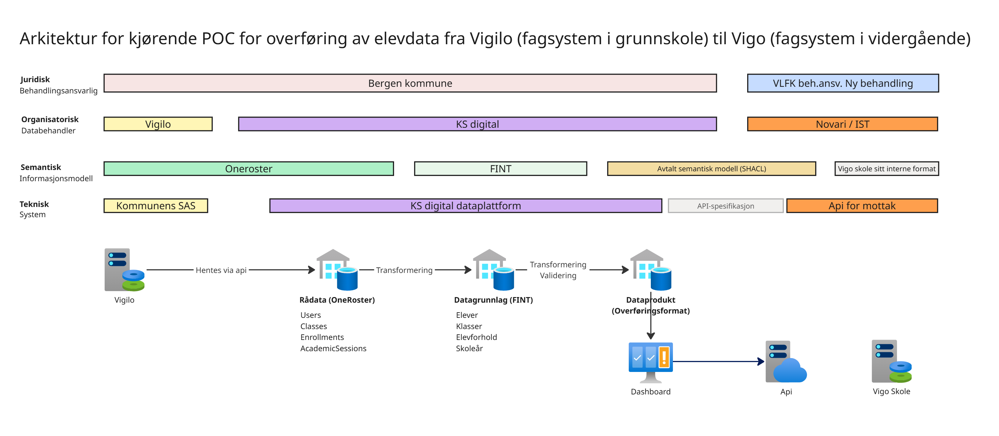

## Architecture for the running POC - transfer of pupil data from Vigilo to Vigo

This document describes the actually running POC for transferring pupil data from Vigilo (case management system in primary and lower secondary school) to Vigo (case management system in upper secondary school), carried out in the first SAMT-BU project pilot.

The description applies to the **POC as implemented to date** and should not be understood as a target architecture or a future recommended solution.

### **Scope and delimitation**

The purpose of the POC is to:

- verify the technical data flow from source system to receiving system

- test transformation, structure and quality of data

- establish a concrete basis for further assessments

The POC does not include:

- full end-to-end integration with the receiving system

- functional or organisational completion

- full transfer of pupil data from Vigilo to Vigo. The data transfer is limited to the data elements in the first transfer of pupil data from Vigilo to Vigo (Vigilo 1 file).

### **High-level flow**

The running POC consists of the following main steps:

1. Data is retrieved from Vigilo via API.

2) Data is loaded into KS Digital's data platform as raw data.

3. Data is transformed into a structured data foundation (information model FINT v4)

4) A data product, i.e. an ad hoc adaptation of the data in the data foundation to the transfer format, is established based on the agreed information model for transfer of pupil data

5. The transfer format is sent to the receiving interface.

Since the receiving system (Vigo skole) is not operational in the POC, a mock API for Vigo skole (a web app developed by Novari that runs in KS Digital's Azure environment) is used to simulate reception. This makes it possible to verify data flow, structure and quality without blocking the POC work.

### **Semantics and information model**

The POC uses:

- The source system OneRoster 1.1., a standard data model for pupil data (related to data collection)

- overarching information models (FINT v4) to build the data model for the data foundation in the POC. FINT is an information model developed by Novari that makes it possible to exchange data between case management systems in a vendor-independent way.

- an agreed semantic model (modelled in SHACL) for the transfer

Any further harmonisation or extension of the information model is outside the scope of the POC.

### **Architecture sketch**

The architecture diagram shows the architecture as it actually runs in the POC as of the publication date. The sketch describes the architecture at 4 different levels:

- legal (data ownership)

- organisational (data processor)

- semantic (information model)

- technical (data flow)

### **Status**

Changes to the architecture will be documented continuously as the POC evolves.
