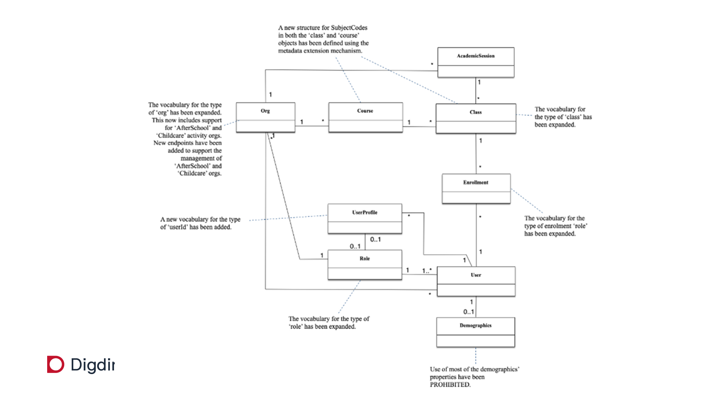

The information models the POC builds on, and the work on common models in phase 1. The source is the demo of information models in sprint 4 (April 2026).

## What was done

- Mapped what happens in the transition between lower secondary and upper secondary school, with an emphasis on information.
- Created a simple conceptual model of the information to be transferred.
- Started on a model for person, expressed in SHACL.
- Mapped relevant concepts, standards and guidelines for primary and lower secondary school.
- Started on a document about what information models are and how they can be used.

The team saw early on that the pilot can get a long way with OneRoster and FINT, and therefore took a step back to look into which standards are relevant for the education domain. Sikt presented its initiatives and how they relate to the EU. Two common models stood out as important: person and organisation.

## OneRoster and the Norwegian profile

[OneRoster](https://www.1edtech.org/standards/oneroster) is an open, international standard from 1EdTech for sharing education data (pupils, teachers, classes and grades) between school administration systems and digital learning platforms. 1EdTech, formerly IMS Global Learning Consortium, is a non-profit organisation that develops open standards for education technology.

The Norwegian profile has these changes:

- extended language support
- demographics updated to Norwegian needs
- support for the Norwegian education structure, out-of-school-hours care (SFO) and kindergarten
- more roles in the education sector
- multiple user identifiers per person
- support for test data to protect privacy
- reporting of pupil absence (in progress)

In the Norwegian profile, the identification properties have been moved from the User class to a separate class (UserID), with this vocabulary:

| Term | Description |
|---|---|
| feideID | Identifier for the Feide user (eduPersonPrincipalName in the Feide documentation) |
| UPN | User name in Azure AD or Microsoft 365, in email format |
| personFIN | Person identifier from VIGO |
| personLIN | Locally assigned ID number |
| personNIN | National identity number, D number or DUF number |
| personNINencrypted | personNIN encrypted so that the sender can decrypt the content |
| sisID | System identifier in the SAS (IPOS/OID) |
| studentID | Pupil number |
| username | Local user name in the SAS |
| workforceID | Employee number |

## FINT

The POC uses FINT v4 as the information model for the data foundation in the data platform. FINT was developed by Novari and makes it possible to exchange data between line-of-business systems independently of the supplier. The lessons-learned report points out that the exchange between the municipality and the county authority in this case works because both have well-defined models (OneRoster and FINT) that cover the data to be transferred.

## Concepts

The team collected definitions of key concepts with sources, particularly for person and identifiers. «Person» is, for example, defined differently in the European Learning Model, W3C's Person Core Vocabulary, FOAF, the Population Register Act (folkeregisterloven), the National Concept Catalogue (Felles begrepskatalog) and FINT. The overview also covers national identity number, fictitious national identity number, D number, DUF number, personal number, Feide ID and norEduPersonNIN, with sources at Udir, the Norwegian Tax Administration (Skatteetaten), UDI and Feide.

## Further work

The project wanted to test a more general information model in practice, but did not complete this in phase 1. The team proposed further work on:

- common models for person and organisation
- format and interface for the models, as a bridge between information architects and developers
- service chains in the education sector that can be published in the service catalogue on data.norge.no

In phase 2, the pilot shall create information model v1 with code lists and machine-readable rules, and consider the European Learning Model and extensions of OneRoster or FINT to cover the transfer of grades (see [Roadmap](/en/pilotering/pilot-1/loesningsvalg/veikart/)). The person model is in the repository [information-models](https://github.com/samt-x/information-models).
