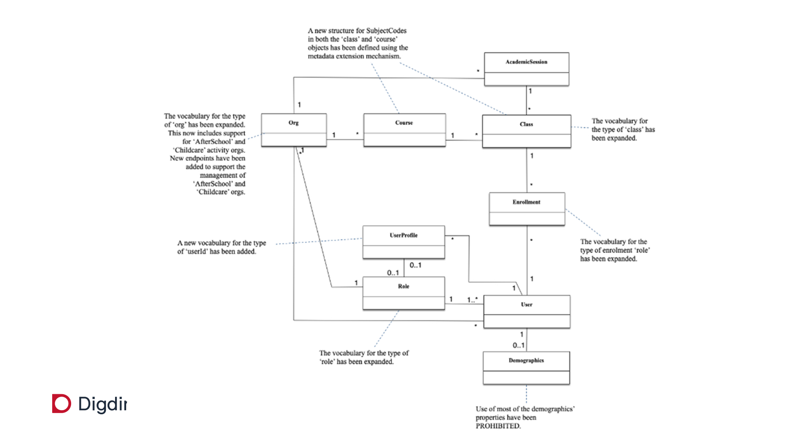

Informasjonsmodellene som POC-en bygger på, og arbeidet med felles modeller i fase 1. Kilden er demoen for informasjonsmodeller i sprint 4 (april 2026).

## Hva som ble gjort

- Kartlagt hva som skjer i overgangen mellom ungdomsskole og videregående, med vekt på informasjon.
- Laget en enkel konseptuell modell over informasjonen som skal overføres.
- Startet på en modell for person, uttrykt i SHACL.
- Kartlagt relevante begreper, standarder og føringer for grunnskolen.
- Startet på et dokument om hva informasjonsmodeller er, og hvordan de kan brukes.

Teamet så tidlig at piloten kommer langt med OneRoster og FINT, og tok derfor et steg tilbake for å orientere seg om hvilke standarder som er relevante for utdanningsområdet. Sikt orienterte om sine initiativer og hvordan de forholder seg til EU. To felles modeller pekte seg ut som viktige: person og organisasjon.

## OneRoster og den norske profilen

[OneRoster](https://www.1edtech.org/standards/oneroster) er en åpen, internasjonal standard fra 1EdTech for deling av utdanningsdata (elever, lærere, klasser og karakterer) mellom skoleadministrative systemer og digitale læringsplattformer. 1EdTech, tidligere IMS Global Learning Consortium, er en ideell organisasjon som utvikler åpne standarder for utdanningsteknologi.

Den norske profilen har disse endringene:

- utvidet språkstøtte
- oppdatert demografi etter norske behov
- støtte for norsk utdanningsstruktur, SFO og barnehage
- flere roller i utdanningssektoren
- flere brukeridentifikatorer per person
- støtte for testdata for å beskytte personvernet
- rapportering av elevfravær (under arbeid)

I den norske profilen er egenskapene for identifikasjon flyttet fra User-klassen til en egen klasse (UserID), med dette vokabularet:

| Term | Beskrivelse |
|---|---|
| feideID | Identifikator for Feide-brukeren (eduPersonPrincipalName i Feide-dokumentasjonen) |
| UPN | Brukernavn i Azure AD eller Microsoft 365, på e-postformat |
| personFIN | Personidentifikator fra VIGO |
| personLIN | Lokalt tildelt id-nummer |
| personNIN | Fødselsnummer, D-nummer eller DUF-nummer |
| personNINencrypted | personNIN kryptert slik at avsender kan dekryptere innholdet |
| sisID | Systemidentifikator i SAS (IPOS/OID) |
| studentID | Elevnummer |
| username | Lokalt brukernavn i SAS |
| workforceID | Ansattnummer |

## FINT

POC-en bruker FINT v4 som informasjonsmodell for datagrunnlaget i dataplattformen. FINT er utviklet av Novari og gjør det mulig å utveksle data mellom fagsystemer uavhengig av leverandør. Erfaringsrapporten peker på at utvekslingen mellom kommune og fylkeskommune i dette caset fungerer fordi begge har godt definerte modeller (OneRoster og FINT) som dekker dataene som skal overføres.

## Begreper

Teamet samlet definisjoner av sentrale begreper med kilder, særlig for person og identifikatorer. «Person» er for eksempel definert ulikt i European Learning Model, W3Cs Person Core Vocabulary, FOAF, folkeregisterloven, Felles begrepskatalog og FINT. Oversikten dekker også fødselsnummer, fiktivt fødselsnummer, D-nummer, DUF-nummer, personnummer, Feide-id og norEduPersonNIN, med kilder hos Udir, Skatteetaten, UDI og Feide.

## Videre arbeid

Prosjektet ville teste en mer generell informasjonsmodell i praksis, men kom ikke i mål med det i fase 1. Teamet foreslo å arbeide videre med:

- felles modeller for person og virksomhet
- format og grensesnitt for modellene, som en bro mellom informasjonsarkitekter og utviklere
- tjenestekjeder i utdanningssektoren som kan publiseres i tjenestekatalogen på data.norge.no

I fase 2 skal piloten lage informasjonsmodell v1 med kodeverk og maskinlesbare regler, og vurdere European Learning Model og utvidelser av OneRoster eller FINT for å dekke overføring av karakterer (se [Veikart](/pilotering/pilot-1/loesningsvalg/veikart/)). Personmodellen ligger i repoet [information-models](https://github.com/samt-x/information-models).
