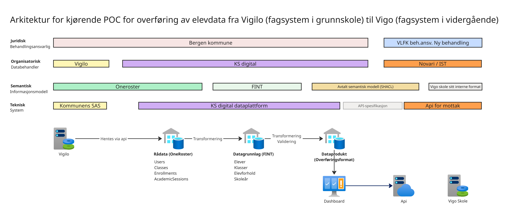
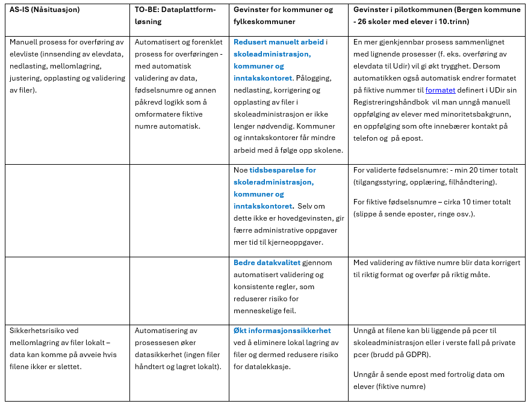
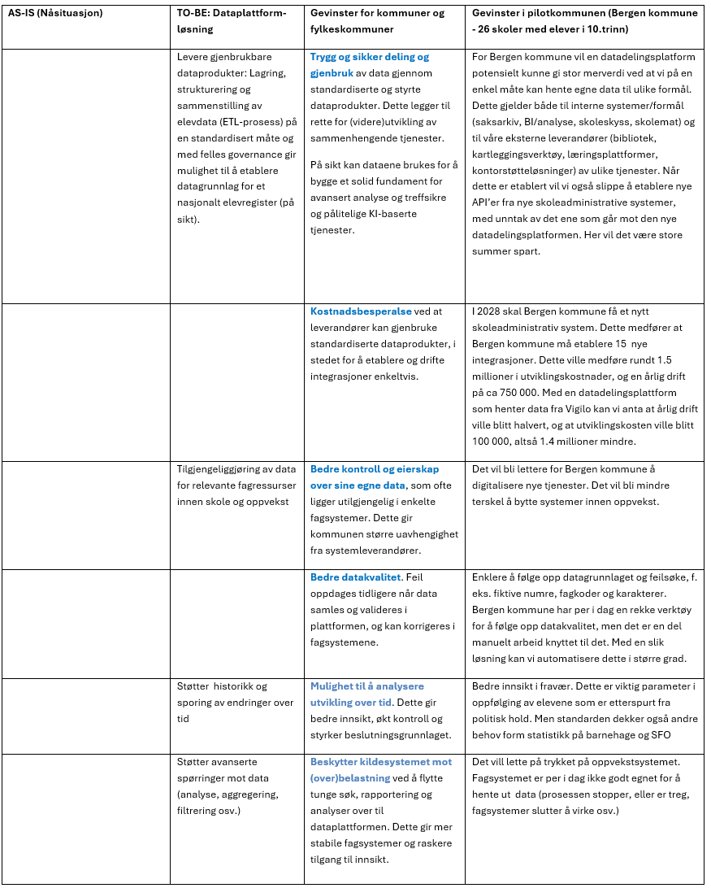

The POC built in phase 1: transfer of pupil data from Vigilo (line-of-business system in primary and lower secondary school) to Vigo (line-of-business system in upper secondary) via KS Digital's data platform. The description applies to the POC as implemented, and is not a target architecture or a recommended future solution.

## Desired data flow

The sketch shows how the transfer of pupil lists becomes **simpler, automated and more secure** with a data platform as an intermediate layer (KS Digital's service platform). The main change is that manual file handling is replaced by automated data flow between the systems. The platform is also built so that the data can be used further, for example for reporting and statistics, and for developing seamless services.

## Scope and delimitation

The POC was to:

- verify the technical data flow from source system to receiving system
- test transformation, structure and quality of data
- provide a concrete basis for further assessments

The POC does not include:

- full end-to-end integration with the receiving system
- functional or organisational completion
- full transfer of pupil data. The transfer is limited to the data elements in the first transfer from Vigilo to Vigo (the Vigo 1 file).

## High-level flow

1. Data is retrieved from Vigilo via API.
2. Data is loaded into KS Digital's data platform as raw data.
3. Data is transformed into a structured data foundation (the information model FINT v4).
4. A data product, an adaptation of the data foundation to the transfer format, is created according to the agreed information model for the transfer of pupil data.
5. The transfer format is sent to the receiving interface.

The receiving system (Vigo Skole) was not operational in the POC. A simulated API for Vigo Skole, a web application developed by Novari that runs in KS Digital's Azure environment, received the data. This made it possible to verify data flow, structure and quality without blocking the work.

## Semantics and information model

The POC uses:

- OneRoster 1.1 in the source system, a standard data model for pupil data
- FINT v4 as the overarching information model for the data foundation. FINT was developed by Novari and makes it possible to exchange data between line-of-business systems independently of the supplier.
- an agreed semantic model for the transfer, modelled in SHACL

More about the models under [Information architecture](/en/pilotering/pilot-1/loesningsvalg/informasjonsarkitektur/). Further harmonisation or extension of the information model was outside the scope of the POC.

## Architecture sketch

The sketch shows the architecture as it ran in the POC, at four levels: legal (data ownership), organisational (processor), semantic (information model) and technical (data flow).

## Benefits

The benefits fall into two groups: operational benefits linked to a better process for transferring pupil data, and strategic benefits linked to establishing and using a data platform as an intermediate layer. The findings from Bergen have been quality-assured in Arendal, Bykle and Vestland county authority.

### Operational benefits

### Strategic benefits

