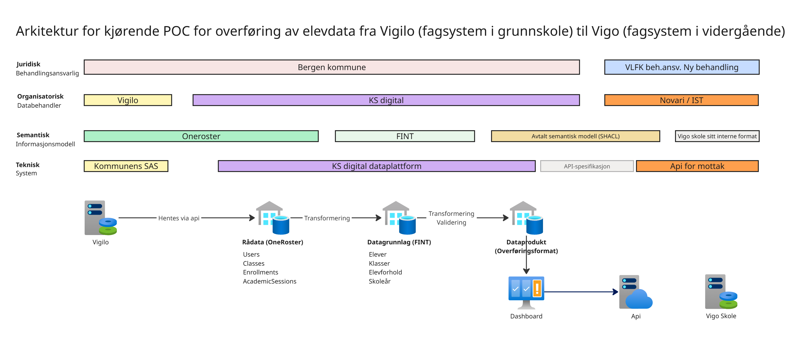
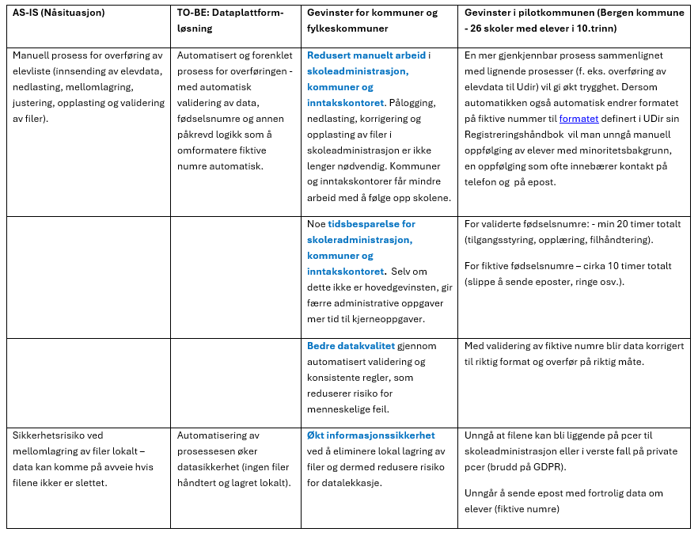
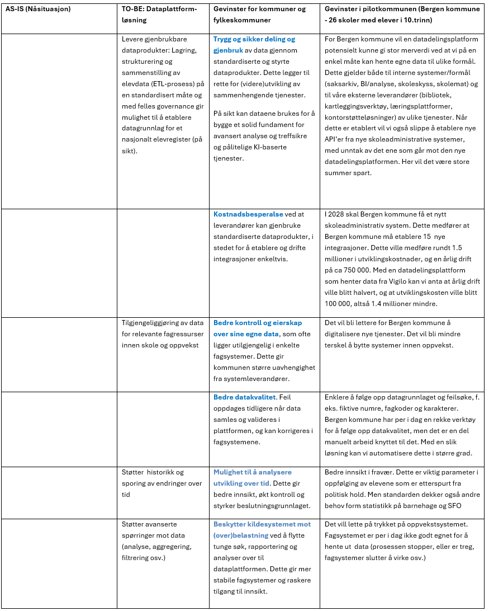

POC-en som ble bygget i fase 1: overføring av elevdata fra Vigilo (fagsystem i grunnskolen) til Vigo (fagsystem i videregående) via KS Digitals dataplattform. Beskrivelsen gjelder POC-en slik den ble implementert, og er ikke en målarkitektur eller anbefalt framtidig løsning.

## Ønsket dataflyt

Skissen viser hvordan overføringen av elevlister blir **forenklet, automatisert og sikrere** med en dataplattform som mellomlag (KS Digitals tjenesteplattform). Hovedendringen er at manuell filhåndtering erstattes av automatisert dataflyt mellom systemene. Plattformen er også bygget slik at dataene kan brukes videre, for eksempel til rapportering og statistikk, og til å utvikle sammenhengende tjenester.

## Omfang og avgrensning

POC-en skulle:

- verifisere teknisk dataflyt fra kildesystem til mottakssystem
- teste transformasjon, struktur og kvalitet på data
- gi et konkret grunnlag for videre vurderinger

POC-en omfatter ikke:

- full ende-til-ende-integrasjon mot mottakssystemet
- funksjonell eller organisatorisk ferdigstilling
- full overføring av elevdata. Overføringen er avgrenset til dataelementene i den første overføringen fra Vigilo til Vigo (Vigo 1-fila).

## Overordnet flyt

1. Data hentes fra Vigilo via API.
2. Data lastes inn i KS Digitals dataplattform som rådata.
3. Data transformeres til et strukturert datagrunnlag (informasjonsmodellen FINT v4).
4. Et dataprodukt, en tilpasning av datagrunnlaget til overføringsformatet, lages etter den avtalte informasjonsmodellen for overføring av elevdata.
5. Overføringsformatet sendes til mottakergrensesnittet.

Mottakssystemet (Vigo Skole) var ikke operativt i POC-en. Et simulert API for Vigo Skole, en webapplikasjon Novari har utviklet og som kjører i KS Digitals Azure-miljø, tok imot dataene. Slik kunne dataflyt, struktur og kvalitet verifiseres uten å blokkere arbeidet.

## Semantikk og informasjonsmodell

POC-en bruker:

- OneRoster 1.1 i kildesystemet, en standard datamodell for elevdata
- FINT v4 som overordnet informasjonsmodell for datagrunnlaget. FINT er utviklet av Novari og gjør det mulig å utveksle data mellom fagsystemer uavhengig av leverandør.
- en avtalt semantisk modell for overføringen, modellert i SHACL

Mer om modellene under [Informasjonsarkitektur](/pilotering/pilot-1/loesningsvalg/informasjonsarkitektur/). Videre harmonisering eller utvidelse av informasjonsmodellen var utenfor POC-en.

## Arkitekturskisse

Skissen viser arkitekturen slik den kjørte i POC-en, på fire nivåer: juridisk (dataeierskap), organisatorisk (databehandler), semantisk (informasjonsmodell) og teknisk (dataflyt).

## Gevinster

Gevinstene er delt i to: operative gevinster knyttet til en bedre prosess for overføring av elevdata, og strategiske gevinster knyttet til å etablere og bruke en dataplattform som mellomlag. Funnene fra Bergen er kvalitetssikret i Arendal, Bykle og Vestland fylkeskommune.

### Operative gevinster

### Strategiske gevinster

